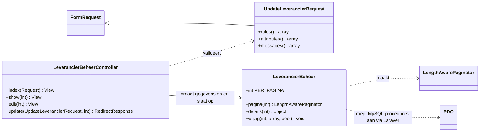

# Klasse-diagram – Wijzigen leverancier

De routes gebruiken de gate `wijzig-leveranciers`. Het beheer accepteert de rol
`manager` en de bestaande beheerdersrol `admin`.

MySQL beperkt het overzicht tot vier records per aanroep. De detailprocedure
koppelt `Leverancier` en `Contact` via `ContactId`. Bij opslaan vergrendelt de
updateprocedure de leverancier, verwerkt zij de wijzigingen in beide tabellen en
wordt bij een SQL-fout de hele transactie teruggedraaid.
